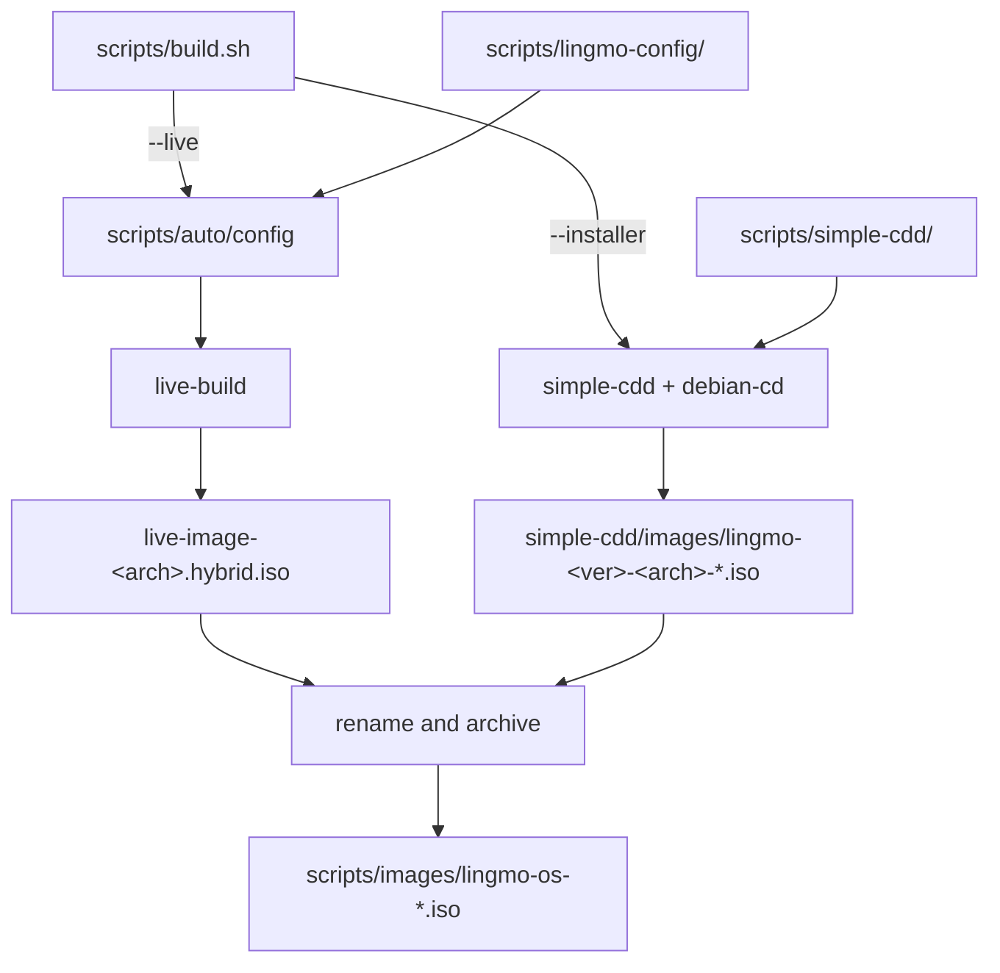
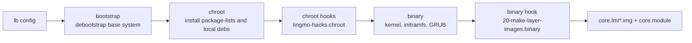
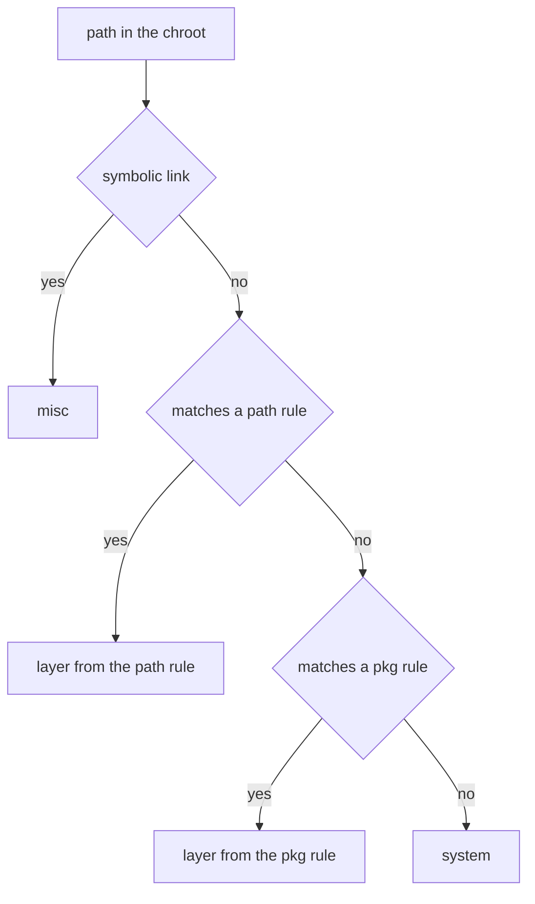

# lingmo-builder

ISO build repository for Lingmo OS.

License: GNU General Public License v3.0, see [LICENSE](LICENSE).

## Architecture

The repository contains two independent build pipelines, selected by `--live` (default) or `--installer` on `scripts/build.sh`.



| Pipeline | Toolchain | Configuration root | Intermediate output | Archive path |
| --- | --- | --- | --- | --- |
| live | live-build | `scripts/lingmo-config/` | `scripts/live-image-<arch>.hybrid.iso` | `scripts/images/lingmo-os-<sysver>-<vert>[-<buildver>]-desktop-<arch>.iso` |
| installer | simple-cdd, debian-cd | `scripts/simple-cdd/` | `scripts/simple-cdd/images/lingmo-<ver>-<arch>-<type>-1.iso` | `scripts/images/lingmo-os-<ver>-installer[-<variant>]-<arch>.iso` |

The live image includes the Calamares installer. After installation, Calamares removes itself and the live components from the target system.

## Build environment

The build host must run a Debian-based distribution, as root or with `sudo` available. `build.sh` terminates when neither condition holds.

| Pipeline | Dependency | Minimum version |
| --- | --- | --- |
| live | `live-build` | `1:20230502` |
| live | `debootstrap` | `1.0.97` |
| installer | `simple-cdd` | `0.6.9` |
| installer | `debian-cd` | `3.2.1` |

`live-build` must be Lingmo's branch, whose version string contains `+lingmo`. Upstream handling of `LB_LIVE_DIR` is documented in item 10 of [TODO.md](TODO.md).

Additional environment requirements:

- `auto/config` creates a `<codename> -> sid` symbolic link under `/usr/share/live/build/data/debian-cd/`. The debian-cd data directory shipped with live-build has no entry for unknown distributions. When the directory is not writable, the script prints the `ln -sf` command to run manually and terminates.
- The layering hook creates `scripts/layer-work/` beside the chroot and references layer files through hard links, so that directory and the chroot must reside on the same filesystem.
- Python is used only by the CI version consistency check (`lingmo-version`). The build itself requires neither Python nor Node.js.

## Repository layout

```
.
├── LICENSE                        GNU General Public License v3.0
├── TODO.md                        Open items and known limitations
├── .getopt.sh                     Command-line option table for build.sh
├── scripts/
│   ├── build.sh                   Build entry point
│   ├── build_all.sh               Wrapper that invokes build.sh
│   ├── make-sums                  Generates checksum files (invocation commented out)
│   ├── auto/
│   │   ├── config                live-build auto/config
│   │   └── clean                 live-build auto/clean
│   ├── simple-cdd/                Installer image configuration
│   └── lingmo-config/             live image configuration root
├── tools/
│   ├── build_version.sh           Build counter (sourced by build.sh, invocation commented out)
│   ├── build_version_2.sh         Generates the CI release tag
│   ├── pkg_build/                 lingmo-pkgbuild packaging tool, independent of the ISO build
│   ├── config.sh                  Legacy script, not invoked by the build
│   ├── default.xml                Repo manifest, not invoked by the build
│   └── update_status.sh           Status file writer, not invoked by the build
└── .github/workflows/build.yml
```

`scripts/lingmo-config/` splits configuration into a common layer and per-variant layers: `common/` holds the shared configuration and `variant-<name>/` is applied per variant.

| Path | Content |
| --- | --- |
| `common/archives/` | Build-time APT sources. `lingmo.list.{chroot,binary}` point at `r2packages.lingmo.org`; `firmware.list.binary` points at the testing non-free component of `deb.debian.org` |
| `common/package-lists/` | chroot package lists: `lingmo_default_chroot`, `hardware-support`, `virtualization`, `linux-headers`, `standard`, `lingmo_extra_list_bookworm`; the binary stage uses `lingmo_default_binary` |
| `common/packages.chroot/` | Local debs installed into the chroot, see [polkit version override](#polkit-version-override) |
| `common/preseed/` | debconf preseed for the chroot stage |
| `common/hooks/live/lingmo-hacks.chroot` | chroot-stage customisation script |
| `common/hooks/live/20-make-layer-images.binary` | binary-stage layering script |
| `common/includes.chroot_after_packages/` | Files copied into the rootfs: polkit rules, `/bin/config-installer`, `/etc/skel`, Plasma themes, live-config hooks `1165-*` and `1166-*` |
| `common/includes.binary/` | Files written to the ISO root: `Version`, `README`, `licenses/`, `autorun.inf`, `setup.exe` |
| `common/includes.installer/` | Installer-stage files: `preseed.cfg`, `lingmo-finish-install`, `finish-install.d/`, `live-installer.d/` |
| `common/bootloaders/grub-pc/` | GRUB menu and theme |
| `common/layer-images.conf` | Layer mapping table |
| `variant-everything/package-lists/` | Three lists: `all`, `lingmo`, `lingmo_everything` |
| `variant-minimal/` | Contains only `.empty`; adds no package list |
| `variant-default` | Pointer file whose content is `variant-everything` |
| `installer-<variant>/packages` | Package list for each installer variant |

## Build preparation

The following conditions apply before a build is started, which must run from `scripts/`.

**1. Working directory**

`build.sh` sources `../tools/build_version.sh` through a relative path, so the script must be started from `scripts/`.

**2. Location of `.getopt.sh`**

`build.sh` loads the option table from `$(dirname $0)/.getopt.sh`. The file resides at the repository root and has no copy under `scripts/`:

```sh
cp .getopt.sh scripts/
```

**3. Type of `variant-default`**

`variant-default` is currently a regular file, so the directory check in `build.sh` does not pass and `cp -rTL` in `auto/config` copies the file itself into `config/`. It must be converted to a symbolic link:

```sh
cd scripts/lingmo-config
ln -sfn "$(cat variant-default)" variant-default.dir && mv -T variant-default.dir variant-default
```

CI performs the equivalent operations:

```sh
TARGET=$(cat variant-default)
ln -sfn "$TARGET" variant-default-dir
mv variant-default-dir variant-default
```

## Build commands

live image build:

```sh
cd scripts
sudo ./build.sh                          # equivalent to --live --variant default
sudo ./build.sh --variant everything
sudo ./build.sh --variant minimal
sudo ./build.sh -a amd64 -D              # prints script internals and writes commands to the log
sudo ./build.sh --no-clean               # keeps the previous build directory
sudo ./build.sh --clean                  # clean only
sudo ./build.sh --get-image-path         # prints the target image name and exits
```

installer image build:

```sh
cd scripts
sudo ./build.sh --installer --variant default
sudo ./build.sh --installer --variant netinst
sudo ./build.sh --installer --variant everything
sudo ./build.sh --installer --version 26a13
```

## Command-line options

The option table is defined in `.getopt.sh`.

| Option | Effect |
| --- | --- |
| `-d` / `--distribution <dist>` | Distribution, default `trixie` |
| `-a` / `--arch <arch>` | Target architecture, default `dpkg --print-architecture`; `x64` maps to `amd64`, `x86` to `i386` |
| `--variant <name>` | live or installer variant name |
| `--version <ver>` | Overrides `LINGMO_VERSION`, affecting the installer image name |
| `--live` / `--installer` | Selects the pipeline, default `live` |
| `--subdir <dir>` | Writes the output to `images/<dir>/` |
| `--clean` | Performs cleanup only |
| `--no-clean` | Skips cleanup |
| `--get-image-path` | Prints the target image name and exits |
| `-p` / `--proposed-updates` | Not implemented. `auto/config` prints a notice that Debian has no proposed-updates; the code that writes the APT source is commented out |
| `-v` / `--verbose` | Writes command output to the terminal as well |
| `-D` / `--debug` | Prints script internals |
| `-s` / `--salt` | Argument-less switch; the script shifts it and performs no further handling |
| `-h` / `--help` | Prints usage |

Cross-architecture builds support only mutual builds between `amd64` and `i386`. Other combinations terminate when `IMAGE_TYPE` is `live`; the `installer` pipeline is exempt.

## Environment variables

| Variable | Default | Effect |
| --- | --- | --- |
| `LB_LIVE_DIR` | `core.lm` | Medium directory name inside the ISO. `auto/config` writes it into `live-media-path=` in `--bootappend-live`; Lingmo's live-build fork uses it to determine `binary/<dir>` |
| `LINGMO_LAYERED_ROOTFS` | `yes` | Controls whether the rootfs is split into multiple `.img` files. Any value other than `yes` makes the hook skip layering, leaving a single `filesystem.squashfs` in the ISO |
| `LINGMO_LAYER_MODULE` | `core` | Layer manifest file name (`core.module`), also written into the `module=` kernel argument |

The remaining build parameters are internal to `build.sh` and have no command-line switch:

| Variable | Value |
| --- | --- |
| `LINGMO_SYS_VERSION` | `5.0` |
| `LINGMO_VERTYPE` | `canary` |
| `LINGMO_BUILD_VER` | `26a13` |

These variables have a second copy in `lingmo-hacks.chroot`; changes must be applied to both, see [Version information](#version-information).

## live build pipeline

`scripts/auto/config` is invoked by `lb config` and performs these steps:

1. Determine the mirror. If `scripts/.mirror` exists its content is used, otherwise `http://ftp.debian.org/debian`. The distribution used by debootstrap is read from the `Codename:` field of `wget .../dists/<dist>/Release`.
2. Create the debian-cd symbolic link.
3. Stack the configuration, in order: `cp -rT lingmo-config/common config`; `cp -rTL lingmo-config/variant-<variant> config`; `lb config noauto` with additional arguments.



Principal arguments of the `lb config` invocation:

| Argument | Value and effect |
| --- | --- |
| `--apt-recommends` | `false`. Recommends dependencies are not installed; required packages must be declared explicitly in `package-lists/` |
| `--mirror-chroot-security` | `http://deb.debian.org/debian-security`. `security.debian.org` is a single endpoint and unreliable from CI |
| `--mirror-binary-security` | `http://deb.debian.org/debian-security` |
| `--apt-options` | `DPkg::Options::="--force-confnew"`, `-y`, `Acquire::Retries=5`, `Acquire::http::Timeout=30` |
| `--bootappend-live` | `boot=live components quiet splash noeject live-media-path=${LB_LIVE_DIR:-live} module=${LINGMO_LAYER_MODULE:-core}` |
| `--bootappend-live-failsafe` | `boot=live components noeject memtest noapic noapm nodma nomce nolapic nomodeset nosmp nosplash vga=normal` |
| `--debootstrap-options` | `--include=apt-transport-https,ca-certificates,openssl` |
| `--bootloaders` | `grub-efi grub-pc` |
| `--uefi-secure-boot` | `enable` |
| `--linux-packages` | `linux-image linux-headers` |
| `--memtest` | `memtest86+` |
| `--iso-volume` | `Lingmo OS 5.x` |

Per-architecture arguments:

| Architecture | Additional arguments |
| --- | --- |
| `i386` | `--linux-flavours 686-pae` |
| `arm64` | `--bootloaders grub-efi --uefi-secure-boot disable` |
| `armel`, `armhf` | `--binary-images hdd --binary-filesystem ext4 --chroot-filesystem none` |

The invocation is a single command with line continuations. Comment lines cannot be inserted inside it and continuation characters cannot be omitted.

### polkit version override

`common/packages.chroot/` contains five debs of polkit version 122-3:

| Package |
| --- |
| `libpolkit-agent-1-0` |
| `libpolkit-gobject-1-0` |
| `pkexec` |
| `policykit-1` |
| `polkitd` |

Packages in `packages.chroot/` take precedence over the APT archive, holding polkit at version 122-3. This deb set is built for amd64 only; builds for other architectures fail to install it.

`includes.chroot_after_packages/etc/polkit-1/rules.d/50-accounts.rules` defines the account management rule:

```javascript
polkit.addRule(function(action, subject) {
    if (action.id == "org.freedesktop.accounts.user-administration" &&
        subject.isInGroup("sudo")) {
        return polkit.Result.YES;
    }
});
```

Members of the `sudo` group perform `org.freedesktop.accounts.user-administration` actions without additional authentication.

## Layered root filesystem

During the binary stage, `20-make-layer-images.binary` splits the rootfs into nine `.img` files and writes the `core.module` manifest. The `unpackfs` module of Calamares unpacks layer by layer, so only the layers that changed are written.

The layer order is fixed by the `ORDER` variable in the hook; layers later in the list take precedence:

```
system firmware kernel desktop lingmo apps vendor device misc
```

`core.module` lists one layer file name per line in the same order as `ORDER`. Empty layers still produce an `.img` file, so the layer count is constant and the unpack list used by Calamares does not change with the mapping table.

`layer-images.conf` maps paths to layers, three columns per line, with `#` starting a comment:

```
path  <path prefix>   <layer>
pkg   <package glob>  <layer>
```

Resolution order:



1. Symbolic links are assigned to `misc`, independent of the owning package.
2. `path` rules are matched in file order; the first match applies.
3. `pkg` rules are matched in file order; the first match applies.
4. Paths matching no rule are assigned to `system`.

The current `path` rules cover `/vendor`, `/device`, `/boot`, `/lib/modules`, `/usr/lib/modules` and `/usr/src`. The `pkg` rules distribute kernels and firmware, display and input-method components, `lingmo-*` packages and applications across `kernel`, `firmware`, `desktop`, `lingmo` and `apps`. `pkg * system` is the final line and must remain last.

Hook procedure:

1. Enumerate each package's files with `dpkg-query --admindir=chroot/var/lib/dpkg`; the package name is resolved through the `pkg` rules first.
2. Collect symbolic links (all assigned to `misc`) and directories in a single `find` pass. Directories are created with a separate `mkdir -p` and are not passed to `cp`.
3. Collect every real file in the chroot, subtract the package file lists, and assign the remainder (hook output, initramfs and similar) to `system`.
4. Distribute paths into per-layer lists, hard-link each layer with `cp -dl --parents`, and generate `<layer>.img` with `mksquashfs -comp xz`.
5. Add the FHS skeleton directories (`dev`, `proc`, `sys`, `run`, `tmp`, `root`, `home`, `srv`, `opt`, `mnt`, `media`, `etc`, `var`, `usr`, `boot`) to the `system` layer.
6. Write `core.module` with `misc.img` as the last line.
7. Delete `filesystem.squashfs` after all steps succeed.

Adding or removing a layer requires changes in the following locations:

1. `scripts/lingmo-config/common/layer-images.conf`
2. The `ORDER` variable in `scripts/lingmo-config/common/hooks/live/20-make-layer-images.binary`
3. The layer list in `calamares/modules/unpackfs.conf` in the `lingmo-installer-config` repository

## Output naming

`target_image_name()` in `build.sh` generates the image name.

live:

```
lingmo-os-${LINGMO_SYS_VERSION}-${LINGMO_VERTYPE}-${LINGMO_BUILD_VER}-desktop-${LINGMO_ARCH}.${ext}
```

Current values are `5.0`, `canary` and `26a13`; an example output is `lingmo-os-5.0-canary-26a13-desktop-amd64.iso`.

When `LINGMO_VARIANT` is not `default`, no hyphen is inserted between `LINGMO_VERTYPE` and `LINGMO_BUILD_VER`; an example output is `lingmo-os-5.0-canary26a13-desktop-amd64.iso`. The behaviour is determined by the branches of `target_image_name()`.

installer:

```
lingmo-os-${LINGMO_VERSION}-installer[-${LINGMO_VARIANT}]-${LINGMO_ARCH}.${ext}
```

`LINGMO_VERSION` defaults to the distribution codename (`trixie`) and is overridden by `--version`.

For `armel` and `armhf`, `auto/config` appends `--binary-images hdd --binary-filesystem ext4 --chroot-filesystem none` and the output extension is `.img`.

### live-build output files

live-build writes a `live-image-<arch>.*` file set under `scripts/`.

| File | Content | Handling by `build.sh` |
| --- | --- | --- |
| `live-image-<arch>.hybrid.iso` | Hybrid ISO image | Moved to `scripts/images/` and renamed |
| `live-image-<arch>.contents` | File listing of the image | Left in `scripts/` |
| `live-image-<arch>.files` | Per-file listing | Left in `scripts/` |
| `live-image-<arch>.packages` | Package listing of the image | Left in `scripts/` |
| `live-image-<arch>.packages.size` | Package size statistics | Left in `scripts/` |
| `live-image-<arch>.hybrid.iso.zsync` | rsync incremental metadata | Left in `scripts/` |

`build.sh` moves only the `.hybrid.iso` and the build log. The remaining files stay in `scripts/` and are available for auditing and incremental distribution.

## ISO structure

```
core.lm/                        Medium directory, from LB_LIVE_DIR
├── vmlinuz-*                   Kernel, copied from chroot/boot
├── initrd.img-*                initramfs
├── memtest.bin                 Produced by --memtest memtest86+
├── memtest.efi                 Produced by --memtest memtest86+
├── core.module                 Layer manifest
├── system.img
├── firmware.img
├── kernel.img
├── desktop.img
├── lingmo.img
├── apps.img
├── vendor.img
├── device.img
├── misc.img
└── filesystem.squashfs         Deleted by the hook on success, retained on failure
/boot/grub/                     GRUB menu and theme, from common/bootloaders/grub-pc
```

`vmlinuz-*`, `initrd.img-*`, `memtest.bin` and `memtest.efi` are produced by the binary stage of live-build. This repository only specifies their location and neither generates nor renames them.

The `module=core` kernel argument corresponds to `core.module`, and `live-media-path=core.lm` corresponds to the medium directory. Both must remain consistent with `LINGMO_LAYER_MODULE` and `LB_LIVE_DIR`.

## installer pipeline

The installer pipeline does not invoke live-build. `build.sh` performs these steps:

1. Copy `/usr/share/debian-cd` to `simple-cdd/debian-cd`.
2. Overwrite the debian-cd default theme with `common/bootloaders/grub-pc/grub-theme.in`, so live and installer images share one GRUB theme.
3. Generate `simple-cdd/profiles/lingmo.downloads` from `installer-<variant>/packages` and append `tasksel`, which debian-cd requires on the medium.
4. Execute:

```sh
build-simple-cdd --verbose --debug --force-root --conf simple-cdd.conf \
  --dist <codename> --debian-mirror <mirror> \
  --profiles "lingmo offline" --auto-profiles "lingmo offline"
```

The `netinst` variant uses `DISKTYPE=NETINST` with the single profile `lingmo`; all other variants use `DISKTYPE=BD`. `build.sh` contains a `purple` branch (`DISKTYPE=BD` with an additional `lingmo-purple` profile and `debian-installer/theme=Clearlooks-Purple`); the repository has no matching `installer-purple/packages` directory.

`simple-cdd/disc-end-hook` modifies ISO branding, replaces the GRUB theme and recomputes `md5sum.txt` after the image is generated.

## Version information

The top of `hooks/live/lingmo-hacks.chroot` defines the version fields used to generate `/usr/lib/os-release` and `/etc/os-version`:

| Field | Value |
| --- | --- |
| `DISTRO_NAME` | `Lingmo OS` |
| `VERSION` | `5.0` |
| `CODENAME` | `Lithium` |
| `BUILD_VER` | `26a13` |
| `DEBIAN_VER` | `13.7` |
| `VERSION_TYPE` | `Alpha` |
| `BUILD_ID` | `$(date +%Y%m%d)` |
| `BUILD_TIME` | `26102813` |

Changing the version requires synchronised updates in:

1. `LINGMO_SYS_VERSION` and `LINGMO_BUILD_VER` in `build.sh`
2. The fields above in `lingmo-hacks.chroot`
3. `includes.binary/Version`
4. `includes.chroot_after_packages/etc/system/currentVersion`

`/etc/os-version` is regenerated from `os-release` by the same script. `dtkcore`, the system monitor and the device manager read this file. The copy generated by the package carries no build number; regenerating it through the script keeps `OsBuild` consistent with the system version.

The following operations affect first-boot duration; removing them causes a performance regression:

| Operation | Reason |
| --- | --- |
| `ldconfig` | Without warming the dynamic linker cache, `ldconfig.service` measured 11.5 seconds on first boot |
| `glib-compile-schemas /usr/share/glib-2.0/schemas` | Without recompilation, the icon theme defaults in `99-lingmo-defaults.gschema.override` do not take effect |
| `update-initramfs -u` | The preceding step modifies `cryptsetup-initramfs/conf-hook`, so the initramfs must be rebuilt |

## Continuous integration

`.github/workflows/build.yml` triggers on pushes to `main`, pull requests to `main`, and manual `workflow_dispatch` (boolean input `release`, default `true`).

The job runs in a `debian:testing` container with `--privileged` enabled.

| Step | Operation |
| --- | --- |
| 1 | Install `git` and `ca-certificates` |
| 2 | Check out the repository with `fetch-depth: 1` |
| 3 | Version consistency check: clone `LingmoOS/lingmo-version` and `LingmoOS/base-files` into `/tmp`, run `python3 lingmo-version check --base-files /tmp/base-files --builder "$PWD"`, terminate on mismatch |
| 4 | Install build dependencies and `gh` from `cli.github.com` |
| 5 | Replace live-build with Lingmo's branch |
| 6 | Clear the APT cache and `/tmp` |
| 7 | Create `ln -sf sid /usr/share/live/build/data/debian-cd/trixie` |
| 8 | Prepare the build directory: `mkdir build && cp -r scripts/* build/ && cp .getopt.sh build/`, convert `variant-default` to a symbolic link |
| 9 | Execute `cd build && sudo ./build.sh` |
| 10 | Collect `build/images/*.iso` into `artifact/` and upload as `upload-iso` with `actions/upload-artifact@v4`, `compression-level: 0` |
| 11 | On a push to `main`, or a manual run with `release` selected, generate the tag `lingmo-os-$(generate_build_ver)` in the form `lingmo-os-<yyyymmddHHMM>.<short-sha>` |
| 12 | Publish the release |

Details of step 5:

Write `/etc/apt/sources.list.d/lingmo-obs.list`:

```
deb https://download.opensuse.org/repositories/home:/LingmoOS/Debian_13/ /
```

Import `Release.key` and write `/etc/apt/preferences.d/lingmo-live-build`:

```
Package: live-build
Pin: origin download.opensuse.org
Pin-Priority: 1001
```

Execute `apt-get install --allow-downgrades live-build`, then assert that `dpkg-query -W -f='${Version}' live-build` contains `+lingmo` and terminate otherwise. The container ships a newer live-build than Lingmo's branch, so an APT pin is required to select the correct origin.

Behaviour of step 12: when the tag exists, `gh release upload --clobber` is executed; otherwise `gh release create --latest=false`. When the ISO exceeds 2147483648 bytes it is split with `split -b 1900M` into `.part-aa`, `.part-ab` and further parts (GitHub Releases limits a single file to 2 GiB), uploaded individually, and the local parts are removed afterwards.

Pull request builds do not publish.

## Package sources

The repository does not submit packages to OBS; it uses external sources:

| Source | Address | Purpose |
| --- | --- | --- |
| Lingmo repository | `https://r2packages.lingmo.org unstable main` | Referenced by `common/archives/lingmo.list.chroot` and `.binary`; provides desktop components |
| Debian non-free | `deb.debian.org` testing non-free | Referenced by `common/archives/firmware.list.binary`; provides firmware during the binary stage |
| OBS | `home:LingmoOS/Debian_13` | Used by CI to install Lingmo's live-build branch |

The synchronisation relationship between `r2packages.lingmo.org` and OBS is not recorded in this repository.

## License

This project is licensed under the GNU General Public License v3.0. The full text is in [LICENSE](LICENSE).

```
Copyright (C) 2026 Lingmo <lingmo@lingmo.org>

This program is free software: you can redistribute it and/or modify
it under the terms of the GNU General Public License as published by
the Free Software Foundation, either version 3 of the License, or
(at your option) any later version.

This program is distributed in the hope that it will be useful,
but WITHOUT ANY WARRANTY; without even the implied warranty of
MERCHANTABILITY or FITNESS FOR A PARTICULAR PURPOSE.  See the
GNU General Public License for more details.

You should have received a copy of the GNU General Public License
along with this program.  If not, see <https://www.gnu.org/licenses/>.
```

Open items and known limitations are listed in [TODO.md](TODO.md).
