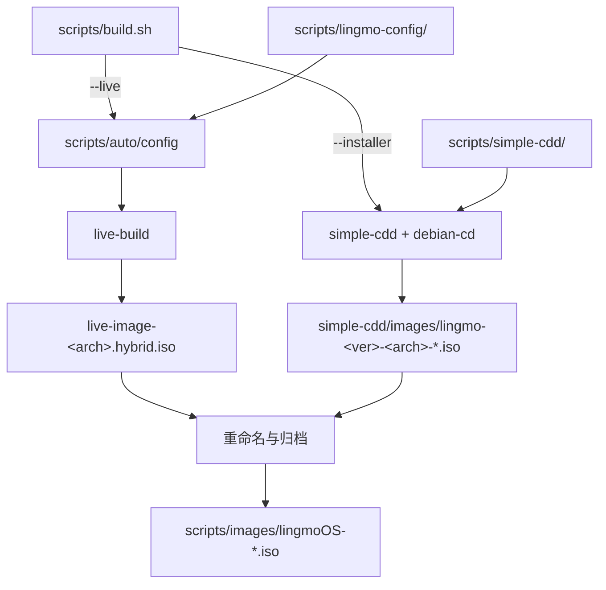
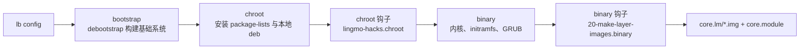
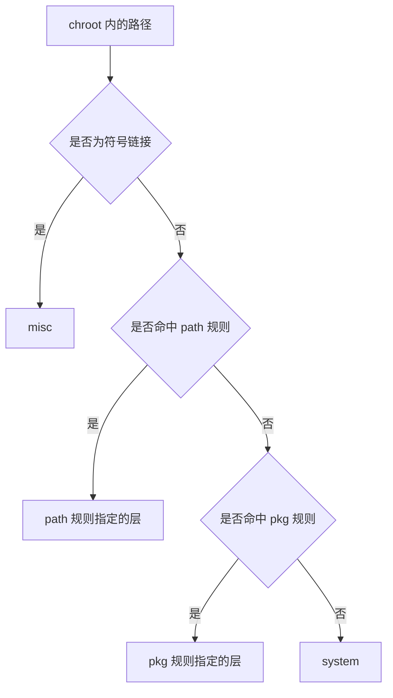

# lingmo-builder

Lingmo OS 的 ISO 构建仓库。

许可证：GNU General Public License v3.0，见 [LICENSE](LICENSE)。

## 架构

仓库包含两条相互独立的构建流水线，由 `scripts/build.sh` 的 `--live`（默认）与 `--installer` 参数选择。



| 流水线 | 工具链 | 配置根目录 | 中间产物 | 归档路径 |
| --- | --- | --- | --- | --- |
| live | live-build | `scripts/lingmo-config/` | `scripts/live-image-<arch>.hybrid.iso` | `scripts/images/lingmoOS-<sysver>-<vert>[-<buildver>]-desktop-<arch>.iso` |
| installer | simple-cdd、debian-cd | `scripts/simple-cdd/` | `scripts/simple-cdd/images/lingmo-<ver>-<arch>-<type>-1.iso` | `scripts/images/lingmoOS-<ver>-installer[-<variant>]-<arch>.iso` |

live 镜像包含 Calamares 安装器。安装完成后，Calamares 从目标系统移除自身与 live 组件。

## 构建环境

构建主机需为基于 Debian 的发行版，以 root 身份运行或具备 `sudo` 权限。`build.sh` 在非 root 且无 `sudo` 时终止执行。

| 流水线 | 依赖 | 最低版本 |
| --- | --- | --- |
| live | `live-build` | `1:20230502` |
| live | `debootstrap` | `1.0.97` |
| installer | `simple-cdd` | `0.6.9` |
| installer | `debian-cd` | `3.2.1` |

`live-build` 需使用 Lingmo 分支，版本号含 `+lingmo`。上游版本对 `LB_LIVE_DIR` 的处理方式见 [TODO.md](TODO.md) 第 10 条。

其他环境要求：

- `auto/config` 在 `/usr/share/live/build/data/debian-cd/` 下创建 `<codename> -> sid` 符号链接。live-build 的 debian-cd 数据目录不含未知发行版条目。目录不可写时，脚本输出需手动执行的 `ln -sf` 命令并终止。
- 分层钩子在 chroot 同级目录创建 `scripts/layer-work/`，层内文件通过硬链接引用，该目录与 chroot 需位于同一文件系统。
- Python 仅用于 CI 的版本一致性检查（`lingmo-version`）。构建过程不依赖 Python 与 Node.js。

## 仓库结构

```
.
├── LICENSE                        GNU General Public License v3.0
├── TODO.md                        待办事项与已知限制
├── .getopt.sh                     build.sh 的命令行选项定义
├── scripts/
│   ├── build.sh                   构建入口
│   ├── build_all.sh               调用 build.sh 的包装脚本
│   ├── make-sums                  生成校验和文件（调用已注释）
│   ├── auto/
│   │   ├── config                live-build 的 auto/config
│   │   └── clean                 live-build 的 auto/clean
│   ├── simple-cdd/                installer 镜像配置
│   └── lingmo-config/             live 镜像配置根
├── tools/
│   ├── build_version.sh           构建号计数器（由 build.sh 引用，调用已注释）
│   ├── build_version_2.sh         生成 CI 发布标签
│   ├── pkg_build/                 lingmo-pkgbuild 打包工具，独立于 ISO 构建
│   ├── config.sh                  遗留脚本，构建过程不调用
│   ├── default.xml                repo manifest，构建过程不调用
│   └── update_status.sh           状态文件写入脚本，构建过程不调用
└── .github/workflows/build.yml
```

`scripts/lingmo-config/` 的配置分为公共层与变体层：`common/` 为公共配置，`variant-<name>/` 按变体追加。

| 路径 | 内容 |
| --- | --- |
| `common/archives/` | 构建期 APT 源。`lingmo.list.{chroot,binary}` 指向 `r2packages.lingmo.org`；`firmware.list.binary` 指向 `deb.debian.org` 的 testing non-free 组件 |
| `common/package-lists/` | chroot 软件包清单：`lingmo_default_chroot`、`hardware-support`、`virtualization`、`linux-headers`、`standard`、`lingmo_extra_list_bookworm`；binary 阶段为 `lingmo_default_binary` |
| `common/packages.chroot/` | 安装至 chroot 的本地 deb 包，见 [polkit 版本覆盖](#polkit-版本覆盖) |
| `common/preseed/` | chroot 阶段的 debconf preseed |
| `common/hooks/live/lingmo-hacks.chroot` | chroot 阶段定制脚本 |
| `common/hooks/live/20-make-layer-images.binary` | binary 阶段分层脚本 |
| `common/includes.chroot_after_packages/` | 覆盖至 rootfs 的文件：polkit 规则、`/bin/config-installer`、`/etc/skel`、Plasma 主题、live-config 钩子 `1165-*`、`1166-*` |
| `common/includes.binary/` | 写入 ISO 根目录的文件：`Version`、`README`、`licenses/`、`autorun.inf`、`setup.exe` |
| `common/includes.installer/` | installer 阶段文件：`preseed.cfg`、`lingmo-finish-install`、`finish-install.d/`、`live-installer.d/` |
| `common/bootloaders/grub-pc/` | GRUB 菜单与主题 |
| `common/layer-images.conf` | 分层映射表 |
| `variant-everything/package-lists/` | `all`、`lingmo`、`lingmo_everything` 三份清单 |
| `variant-minimal/` | 仅含 `.empty`，不追加清单 |
| `variant-default` | 内容为 `variant-everything` 的指针文件 |
| `installer-<variant>/packages` | installer 各变体的软件包清单 |

## 构建准备

构建前需满足以下条件，并在 `scripts/` 目录下执行。

**1. 工作目录**

`build.sh` 通过 `source ../tools/build_version.sh` 引用构建号脚本，路径为相对路径，需在 `scripts/` 目录下执行。

**2. `.getopt.sh` 位置**

`build.sh` 通过 `$(dirname $0)/.getopt.sh` 加载选项定义。该文件位于仓库根目录，`scripts/` 下不存在副本，需复制：

```sh
cp .getopt.sh scripts/
```

**3. `variant-default` 类型**

`variant-default` 当前为普通文件，`build.sh` 的目录检查不通过，`auto/config` 的 `cp -rTL` 将该文件本身复制至 `config/`。需转换为符号链接：

```sh
cd scripts/lingmo-config
ln -sfn "$(cat variant-default)" variant-default.dir && mv -T variant-default.dir variant-default
```

CI 使用等价命令：

```sh
TARGET=$(cat variant-default)
ln -sfn "$TARGET" variant-default-dir
mv variant-default-dir variant-default
```

## 构建命令

live 镜像构建：

```sh
cd scripts
sudo ./build.sh                          # 等价于 --live --variant default
sudo ./build.sh --variant everything
sudo ./build.sh --variant minimal
sudo ./build.sh -a amd64 -D              # 输出脚本内部变量，命令同时写入日志
sudo ./build.sh --no-clean               # 保留上次构建目录
sudo ./build.sh --clean                  # 仅清理
sudo ./build.sh --get-image-path         # 输出目标镜像名后退出
```

installer 镜像构建：

```sh
cd scripts
sudo ./build.sh --installer --variant default
sudo ./build.sh --installer --variant netinst
sudo ./build.sh --installer --variant everything
sudo ./build.sh --installer --version 26a13
```

## 命令行参数

选项定义位于 `.getopt.sh`。

| 参数 | 作用 |
| --- | --- |
| `-d` / `--distribution <dist>` | 发行版，默认 `trixie` |
| `-a` / `--arch <arch>` | 目标架构，默认 `dpkg --print-architecture`；`x64` 映射为 `amd64`，`x86` 映射为 `i386` |
| `--variant <name>` | live 或 installer 变体名 |
| `--version <ver>` | 覆盖 `LINGMO_VERSION`，影响 installer 镜像名 |
| `--live` / `--installer` | 选择流水线，默认 `live` |
| `--subdir <dir>` | 产物写入 `images/<dir>/` |
| `--clean` | 仅执行清理 |
| `--no-clean` | 跳过清理 |
| `--get-image-path` | 输出目标镜像名后退出 |
| `-p` / `--proposed-updates` | 无实现。`auto/config` 输出 Debian 无 proposed-updates 的提示，写入 APT 源的代码已注释 |
| `-v` / `--verbose` | 命令输出同时写入终端 |
| `-D` / `--debug` | 输出脚本内部变量 |
| `-s` / `--salt` | 无参数开关，脚本执行 `shift` 后无其他处理 |
| `-h` / `--help` | 输出用法 |

跨架构构建仅支持 `amd64` 与 `i386` 相互构建。其他组合在 `IMAGE_TYPE` 为 `live` 时终止执行，`installer` 不受此限制。

## 环境变量

| 变量 | 默认值 | 作用 |
| --- | --- | --- |
| `LB_LIVE_DIR` | `core.lm` | ISO 内介质目录名。`auto/config` 将其写入 `--bootappend-live` 的 `live-media-path=`；Lingmo 分支的 live-build 据此确定 `binary/<dir>` |
| `LINGMO_LAYERED_ROOTFS` | `yes` | 控制是否将 rootfs 拆分为多个 `.img`。取值非 `yes` 时钩子跳过分层，ISO 内保留单个 `filesystem.squashfs` |
| `LINGMO_LAYER_MODULE` | `core` | 层清单文件名（`core.module`），同时写入引导参数 `module=` |

其余构建参数为 `build.sh` 内部变量，无对应命令行开关：

| 变量 | 值 |
| --- | --- |
| `LINGMO_SYS_VERSION` | `5.0` |
| `LINGMO_VERTYPE` | `canary` |
| `LINGMO_BUILD_VER` | `26a13` |

上述变量在 `lingmo-hacks.chroot` 中另有副本，修改时需同步，见 [版本信息](#版本信息)。

## live 构建流程

`scripts/auto/config` 由 `lb config` 自动调用，执行步骤：

1. 确定镜像源。`scripts/.mirror` 存在时读取其内容，否则使用 `http://ftp.debian.org/debian`。debootstrap 使用的发行版由 `wget .../dists/<dist>/Release` 的 `Codename:` 字段确定。
2. 创建 debian-cd 符号链接。
3. 叠加配置，依次执行：`cp -rT lingmo-config/common config`；`cp -rTL lingmo-config/variant-<variant> config`；`lb config noauto` 及附加参数。



`lb config` 调用的主要参数：

| 参数 | 取值与作用 |
| --- | --- |
| `--apt-recommends` | `false`。Recommends 依赖不安装，所需软件包须在 `package-lists/` 中显式声明 |
| `--mirror-chroot-security` | `http://deb.debian.org/debian-security`。`security.debian.org` 为单点，CI 环境连接不稳定 |
| `--mirror-binary-security` | `http://deb.debian.org/debian-security` |
| `--apt-options` | `DPkg::Options::="--force-confnew"`、`-y`、`Acquire::Retries=5`、`Acquire::http::Timeout=30` |
| `--bootappend-live` | `boot=live components quiet splash noeject live-media-path=${LB_LIVE_DIR:-live} module=${LINGMO_LAYER_MODULE:-core}` |
| `--bootappend-live-failsafe` | `boot=live components noeject memtest noapic noapm nodma nomce nolapic nomodeset nosmp nosplash vga=normal` |
| `--debootstrap-options` | `--include=apt-transport-https,ca-certificates,openssl` |
| `--bootloaders` | `grub-efi grub-pc` |
| `--uefi-secure-boot` | `enable` |
| `--linux-packages` | `linux-image linux-headers` |
| `--memtest` | `memtest86+` |
| `--iso-volume` | `Lingmo OS 5.x` |

按架构追加的参数：

| 架构 | 追加参数 |
| --- | --- |
| `i386` | `--linux-flavours 686-pae` |
| `arm64` | `--bootloaders grub-efi --uefi-secure-boot disable` |
| `armel`、`armhf` | `--binary-images hdd --binary-filesystem ext4 --chroot-filesystem none` |

该调用为单条命令加续行符，命令内部不可插入注释行，续行符不可省略。

### polkit 版本覆盖

`common/packages.chroot/` 包含五个 polkit 122-3 版本的 deb 包：

| 软件包 |
| --- |
| `libpolkit-agent-1-0` |
| `libpolkit-gobject-1-0` |
| `pkexec` |
| `policykit-1` |
| `polkitd` |

`packages.chroot/` 中的软件包优先于 APT 源安装，将 polkit 版本固定为 122-3。该组 deb 包仅提供 amd64 架构，其他架构构建时安装失败。

`includes.chroot_after_packages/etc/polkit-1/rules.d/50-accounts.rules` 定义账户管理授权规则：

```javascript
polkit.addRule(function(action, subject) {
    if (action.id == "org.freedesktop.accounts.user-administration" &&
        subject.isInGroup("sudo")) {
        return polkit.Result.YES;
    }
});
```

`sudo` 组成员执行 `org.freedesktop.accounts.user-administration` 操作时无需额外认证。

## 分层根文件系统

rootfs 在 binary 阶段由 `20-make-layer-images.binary` 拆分为九个 `.img` 文件，并写入 `core.module` 清单。Calamares 的 `unpackfs` 模块按层解包，可仅写入发生变化的层。

层顺序由钩子的 `ORDER` 变量固定，位于列表后方的层优先级更高：

```
system firmware kernel desktop lingmo apps vendor device misc
```

`core.module` 每行一个层文件名，顺序与 `ORDER` 一致。空层同样生成 `.img` 文件，层数恒定，Calamares 的解包列表不随映射表变化。

`layer-images.conf` 定义路径到层的映射，每行三列，`#` 起始为注释：

```
path  <路径前缀>   <层名>
pkg   <包名glob>   <层名>
```

判定顺序：



1. 符号链接归入 `misc`，与所属软件包无关。
2. 按文件顺序匹配 `path` 规则，首个命中项生效。
3. 按文件顺序匹配 `pkg` 规则，首个命中项生效。
4. 未命中任何规则时归入 `system`。

当前 `path` 规则覆盖 `/vendor`、`/device`、`/boot`、`/lib/modules`、`/usr/lib/modules`、`/usr/src`。`pkg` 规则按内核与固件、显示与输入法组件、`lingmo-*`、常用应用软件划分至 `kernel`、`firmware`、`desktop`、`lingmo`、`apps`。`pkg * system` 为末行，须保持为最后一条规则。

钩子执行步骤：

1. 通过 `dpkg-query --admindir=chroot/var/lib/dpkg` 获取各软件包的文件列表，软件包名先经 `pkg` 规则确定所属层。
2. 通过一次 `find` 调用收集符号链接（全部归入 `misc`）与目录。目录通过独立的 `mkdir -p` 创建，不交由 `cp` 处理。
3. 收集 chroot 内全部实际文件，与软件包文件列表求差集，得到非软件包所有的文件（钩子产物、initramfs 等），归入 `system`。
4. 按规则将路径分配至各层清单，逐层执行 `cp -dl --parents` 建立硬链接，通过 `mksquashfs -comp xz` 生成 `<层>.img`。
5. 将 FHS 骨架目录（`dev`、`proc`、`sys`、`run`、`tmp`、`root`、`home`、`srv`、`opt`、`mnt`、`media`、`etc`、`var`、`usr`、`boot`）加入 `system` 层。
6. 写入 `core.module`，`misc.img` 置于末行。
7. 全部步骤成功后删除 `filesystem.squashfs`。

增加或删除层需同步修改以下位置：

1. `scripts/lingmo-config/common/layer-images.conf`
2. `scripts/lingmo-config/common/hooks/live/20-make-layer-images.binary` 的 `ORDER` 变量
3. `lingmo-installer-config` 仓库 `calamares/modules/unpackfs.conf` 的层列表
## 产物命名

镜像名由 `build.sh` 的 `target_image_name()` 生成。

live：

```
lingmoOS-${LINGMO_SYS_VERSION}-${LINGMO_VERTYPE}-${LINGMO_BUILD_VER}-desktop-${LINGMO_ARCH}.${ext}
```

当前取值 `5.0`、`canary`、`26a13`，输出示例 `lingmoOS-5.0-canary-26a13-desktop-amd64.iso`。

`LINGMO_VARIANT` 不为 `default` 时，`LINGMO_VERTYPE` 与 `LINGMO_BUILD_VER` 之间不插入连字符，输出示例 `lingmoOS-5.0-canary26a13-desktop-amd64.iso`。该行为由 `target_image_name()` 的分支决定。

installer：

```
lingmoOS-${LINGMO_VERSION}-installer[-${LINGMO_VARIANT}]-${LINGMO_ARCH}.${ext}
```

`LINGMO_VERSION` 默认为发行版代号（`trixie`），可由 `--version` 覆盖。

架构为 `armel` 或 `armhf` 时，`auto/config` 追加 `--binary-images hdd --binary-filesystem ext4 --chroot-filesystem none`，产物扩展名为 `.img`。

### live-build 产物文件

live-build 在 `scripts/` 下生成 `live-image-<arch>.*` 文件集。

| 文件 | 内容 | `build.sh` 处理 |
| --- | --- | --- |
| `live-image-<arch>.hybrid.iso` | hybrid ISO 镜像 | 移动至 `scripts/images/` 并重命名 |
| `live-image-<arch>.contents` | 镜像内文件清单 | 保留在 `scripts/` |
| `live-image-<arch>.files` | 文件级清单 | 保留在 `scripts/` |
| `live-image-<arch>.packages` | 镜像内软件包清单 | 保留在 `scripts/` |
| `live-image-<arch>.packages.size` | 软件包体积统计 | 保留在 `scripts/` |
| `live-image-<arch>.hybrid.iso.zsync` | rsync 增量同步元数据 | 保留在 `scripts/` |

`build.sh` 仅移动 `.hybrid.iso` 与构建日志。其余文件保留在 `scripts/`，可用于审计与增量分发。

## ISO 结构

```
core.lm/                        LB_LIVE_DIR 指定的介质目录
├── vmlinuz-*                   内核，由 chroot/boot 复制
├── initrd.img-*                initramfs
├── memtest.bin                 由 --memtest memtest86+ 生成
├── memtest.efi                 由 --memtest memtest86+ 生成
├── core.module                 层清单
├── system.img
├── firmware.img
├── kernel.img
├── desktop.img
├── lingmo.img
├── apps.img
├── vendor.img
├── device.img
├── misc.img
└── filesystem.squashfs         分层成功后由钩子删除，失败时保留
/boot/grub/                     GRUB 菜单与主题，来源 common/bootloaders/grub-pc
```

`vmlinuz-*`、`initrd.img-*`、`memtest.bin`、`memtest.efi` 由 live-build 的 binary 阶段生成。本仓库仅指定其所在目录，不生成、不改名。

引导参数 `module=core` 对应 `core.module`，`live-media-path=core.lm` 对应介质目录，两者需与 `LINGMO_LAYER_MODULE`、`LB_LIVE_DIR` 保持一致。

## installer 构建流程

installer 流水线不调用 live-build。`build.sh` 执行步骤：

1. 复制 `/usr/share/debian-cd` 至 `simple-cdd/debian-cd`。
2. 以 `common/bootloaders/grub-pc/grub-theme.in` 覆盖 debian-cd 默认主题，使 live 与 installer 使用同一 GRUB 主题。
3. 由 `installer-<variant>/packages` 生成 `simple-cdd/profiles/lingmo.downloads`，追加 `tasksel`（debian-cd 要求该包存在于介质中）。
4. 执行：

```sh
build-simple-cdd --verbose --debug --force-root --conf simple-cdd.conf \
  --dist <codename> --debian-mirror <mirror> \
  --profiles "lingmo offline" --auto-profiles "lingmo offline"
```

`netinst` 变体使用 `DISKTYPE=NETINST` 与单一 profile `lingmo`，其余变体使用 `DISKTYPE=BD`。`build.sh` 包含 `purple` 分支（`DISKTYPE=BD`，附加 `lingmo-purple` profile 与 `debian-installer/theme=Clearlooks-Purple`），仓库中无对应 `installer-purple/packages` 目录。

`simple-cdd/disc-end-hook` 在镜像生成后修改 ISO 品牌信息、替换 GRUB 主题、重新计算 `md5sum.txt`。

## 版本信息

`hooks/live/lingmo-hacks.chroot` 顶部定义版本字段，用于生成 `/usr/lib/os-release` 与 `/etc/os-version`：

| 字段 | 值 |
| --- | --- |
| `DISTRO_NAME` | `Lingmo OS` |
| `VERSION` | `5.0` |
| `CODENAME` | `Lithium` |
| `BUILD_VER` | `26a13` |
| `DEBIAN_VER` | `13.7` |
| `VERSION_TYPE` | `Alpha` |
| `BUILD_ID` | `$(date +%Y%m%d)` |
| `BUILD_TIME` | `26102813` |

修改版本时需同步以下位置：

1. `build.sh` 的 `LINGMO_SYS_VERSION`、`LINGMO_BUILD_VER`
2. `lingmo-hacks.chroot` 的上述字段
3. `includes.binary/Version`
4. `includes.chroot_after_packages/etc/system/currentVersion`

`/etc/os-version` 由同一脚本依据 `os-release` 重新生成。`dtkcore`、系统监视器、设备管理器读取该文件。软件包生成的版本不含构建号，由该脚本重新生成可使 `OsBuild` 与系统版本保持一致。

以下操作影响首次启动耗时，移除后性能回退：

| 操作 | 原因 |
| --- | --- |
| `ldconfig` | 未预热动态链接器缓存时，首次启动 `ldconfig.service` 实测耗时 11.5 秒 |
| `glib-compile-schemas /usr/share/glib-2.0/schemas` | 未重新编译时，`99-lingmo-defaults.gschema.override` 中的图标主题默认值不生效 |
| `update-initramfs -u` | 前述步骤修改了 `cryptsetup-initramfs/conf-hook`，需重建 initramfs |

## 持续集成

`.github/workflows/build.yml` 触发条件：推送至 `main`、向 `main` 提交拉取请求、手动触发 `workflow_dispatch`（布尔输入 `release`，默认 `true`）。

任务运行于 `debian:testing` 容器，启用 `--privileged`。

| 步骤 | 操作 |
| --- | --- |
| 1 | 安装 `git`、`ca-certificates` |
| 2 | 检出代码，`fetch-depth: 1` |
| 3 | 版本一致性检查：克隆 `LingmoOS/lingmo-version` 与 `LingmoOS/base-files` 至 `/tmp`，执行 `python3 lingmo-version check --base-files /tmp/base-files --builder "$PWD"`，不一致时终止 |
| 4 | 安装构建依赖，并从 `cli.github.com` 安装 `gh` |
| 5 | 替换 live-build 为 Lingmo 分支 |
| 6 | 清理 APT 缓存与 `/tmp` |
| 7 | 创建 `ln -sf sid /usr/share/live/build/data/debian-cd/trixie` |
| 8 | 准备构建目录：`mkdir build && cp -r scripts/* build/ && cp .getopt.sh build/`，将 `variant-default` 转为符号链接 |
| 9 | 执行 `cd build && sudo ./build.sh` |
| 10 | 收集 `build/images/*.iso` 至 `artifact/`，通过 `actions/upload-artifact@v4` 上传为 `upload-iso`，`compression-level: 0` |
| 11 | 推送至 `main`，或手动触发且勾选 `release` 时生成标签 `lingmoOS-$(generate_build_ver)`，格式为 `lingmoOS-<yyyymmddHHMM>.<short-sha>` |
| 12 | 发布 Release |

步骤 5 的具体操作：

写入 `/etc/apt/sources.list.d/lingmo-obs.list`：

```
deb https://download.opensuse.org/repositories/home:/LingmoOS/Debian_13/ /
```

导入 `Release.key`，写入 `/etc/apt/preferences.d/lingmo-live-build`：

```
Package: live-build
Pin: origin download.opensuse.org
Pin-Priority: 1001
```

执行 `apt-get install --allow-downgrades live-build`，随后断言 `dpkg-query -W -f='${Version}' live-build` 包含 `+lingmo`，否则终止。容器自带的 live-build 版本高于 Lingmo 分支，需通过 APT pin 指定来源。

步骤 12 的行为：标签已存在时执行 `gh release upload --clobber`，不存在时执行 `gh release create --latest=false`。ISO 体积超过 2147483648 字节时，通过 `split -b 1900M` 分割为 `.part-aa`、`.part-ab` 等分片（GitHub Release 单文件上限为 2 GiB），逐个上传后删除本地分片。

拉取请求触发时仅构建，不发布。

## 软件源

仓库不向 OBS 提交软件包，仅使用外部源：

| 源 | 地址 | 用途 |
| --- | --- | --- |
| Lingmo 软件源 | `https://r2packages.lingmo.org unstable main` | `common/archives/lingmo.list.chroot` 与 `.binary` 引用，提供桌面组件 |
| Debian non-free | `deb.debian.org` testing non-free | `common/archives/firmware.list.binary` 引用，binary 阶段获取固件 |
| OBS | `home:LingmoOS/Debian_13` | CI 安装 Lingmo 分支的 live-build |

`r2packages.lingmo.org` 与 OBS 的同步关系未在本仓库中记录。

## 许可证

本项目采用 GNU General Public License v3.0。完整条款见 [LICENSE](LICENSE)。

```
Copyright (C) 2026 Lingmo <lingmo@lingmo.org>

This program is free software: you can redistribute it and/or modify
it under the terms of the GNU General Public License as published by
the Free Software Foundation, either version 3 of the License, or
(at your option) any later version.

This program is distributed in the hope that it will be useful,
but WITHOUT ANY WARRANTY; without even the implied warranty of
MERCHANTABILITY or FITNESS FOR A PARTICULAR PURPOSE.  See the
GNU General Public License for more details.

You should have received a copy of the GNU General Public License
along with this program.  If not, see <https://www.gnu.org/licenses/>.
```

待办事项与已知限制见 [TODO.md](TODO.md)。
